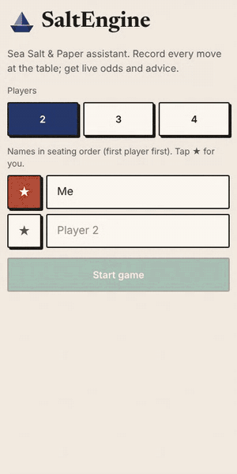
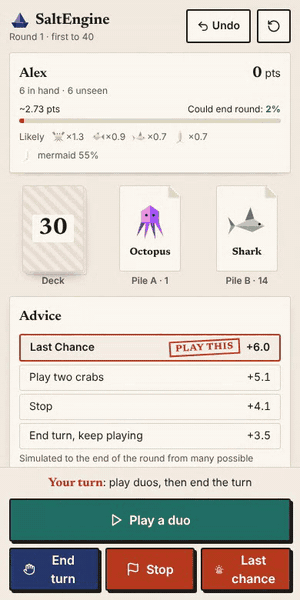
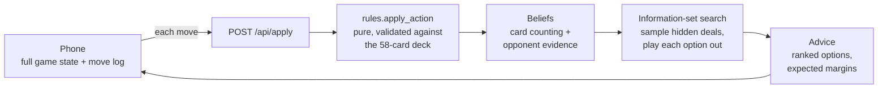

<div align="center">

# SaltEngine

**A table-side analyst for the card game *Sea Salt & Paper*.**
Record the game on your phone as you play; get card counting, opponent reads and move advice backed by simulation.

[](https://salt-engine.vercel.app)


<table>
  <tr>
    <td align="center"></td>
    <td align="center"></td>
    <td align="center"></td>
  </tr>
  <tr>
    <td align="center"><sub>Set up a game</sub></td>
    <td align="center"><sub>Keep this card, discard onto that pile</sub></td>
    <td align="center"><sub>When to call Stop or Last Chance</sub></td>
  </tr>
</table>

</div>

## What it does

You play the physical game as normal and log each move: what you drew, what opponents discarded or took, which duos went down. SaltEngine keeps the full game state and, on your turn, tells you:

- **Where to draw from**: the deck or either discard pile.
- **Which card to keep** when you draw two, and **which pile to discard onto** so the next player gets the least from it.
- **Whether to play a duo now**, and what its effect is worth.
- **Whether to end the round**: keep playing, *Stop*, or *Last Chance*, with the expected margin over the best opponent for each.
- **What each opponent probably holds**, how many points they are likely sitting on, and the chance they can end the round.

It runs in the phone browser with no account and no server-side storage. Undo is one tap.

## How it decides



1. **Rules engine.** Every transition is a pure function `apply_action(state, action) -> state`. After each move the engine checks that the cards on record are consistent with the 58-card deck, so a mistyped card is rejected instead of quietly skewing the maths. Discard piles are derived from an append-only ledger.
2. **Beliefs.** Hidden cards are counted exactly (hypergeometric), with one Bayesian update on top: an opponent who draws blind past a useful discard probably doesn't hold its partner.
3. **Search.** For your current decision, the engine samples complete hidden worlds consistent with what you have seen, applies each candidate action, and plays the round to the end with a fast rollout policy. Every action is tried on the same sampled worlds (common random numbers), so the comparison between options is paired rather than drowned in deal noise. Budget: 150 ms per request.
4. **The API is stateless.** The phone sends the whole state with each move, which is what lets the backend run as a Vercel serverless function.

## Evidence, not intuition

Every engine change had to beat the previous version in a bot arena before it reached the app. The arena plays full games where each seat sees only its own view, advanced through the real rules engine, and seats rotate between games.

| Change | Matchup | Games | Win rate (95% CI) | Shipped? |
|---|---|---:|---|---|
| Baseline engine | greedy vs random | 2,000 | 99.3% [98.8, 99.6] | ✅ |
| Arena fairness check | greedy vs greedy | 1,000 | 51.5% [48.4, 54.6] | ✅ |
| Discard-pile advice | denial vs random pile | 2,000 | 53.1% [51.0, 55.3] | ✅ |
| **Information-set search** | **search vs greedy** | **300** | **75.7% [70.5, 80.2]** | ✅ |
| Particle-filter beliefs | particles vs counting | 1,000 | 51.4% [48.3, 54.5] | ❌ not significant |
| Win-probability evaluator | P(win game) vs round margin | 300 | 52.0% [46.4, 57.6] | ❌ not significant |
| Learned opponent rationality | learned β vs fixed β | 600 | 49.3% [45.3, 53.3] | ❌ not significant |

Three of the seven ideas did not earn their place, so they stay in the codebase and out of the app. The particle filter is still the better model on paper: it handles a steal between two opponents exactly, where simple counting forgets which card moved. But better hand predictions (about 2.5% lower error) did not turn into more wins.

The arena also found two crashes that real players would have hit. Holding a single sailor made the lookahead imagine a third one (`IndexError`), and float rounding in deck estimates did the same thing later. Both now have regression tests that fail without the fix.

## Design

The interface is meant to read like printed paper at a games table:

- **Card art.** Each card is an original faceted, folded-paper drawing, rendered in that card's own colour, so colour (which matters for Mermaids and the colour bonus) is visible at a glance.
- **Paper details.** Cards have a folded corner, buttons are printed with a hard shadow that presses in, and sheets unfold from the bottom of the screen. Motion is off when the phone asks for reduced motion.
- **Type.** Newsreader for headings and numbers, the system font for everything else.
- **Recommendations** carry a red ink stamp. Text contrast is 4.5:1 or better throughout.

## Project layout

```
backend/
  engine/      models, rules (scoring + pure transitions), discard ledger,
               card-counting beliefs, particle-filter beliefs
  solver/      greedy EV calculator, fast simulator, information-set search,
               win-probability model
  arena/       bot arena, bots, self-play value fitting
  api.py       FastAPI app (stateless)
  tests/       pytest suite
api/index.py   Vercel entrypoint
frontend/      React + TypeScript + Tailwind (Vite)
```

## Run it locally

```bash
pip install -r requirements.txt uvicorn pytest httpx
python -m pytest                                  # 50 tests
python -m uvicorn backend.api:app --port 8000
cd frontend && npm install && npm run dev         # proxies /api to :8000
```

Run the arena yourself:

```bash
python -m backend.arena --bots ismcts,greedy --games 300 --seed 12
python -m backend.arena.value_table --games 3000    # refit the win model
```

## Known limits

- **Base game only.** Expansion cards are not modelled.
- **Unseen colours.** There is no per-card colour table, so you tap each card's colour when you see it, and the colours of unseen cards are treated as unknown.
- **Search depth.** The search branches on your current decision only; later choices inside a simulation come from the rollout policy.
- **Instant win.** The four-Mermaid win is checked when the round is scored, not the moment the fourth Mermaid is drawn.

*Sea Salt & Paper* is designed by Bruno Cathala and Théo Rivière and published by Bombyx. SaltEngine is an unofficial fan-made companion and is not affiliated with them.
